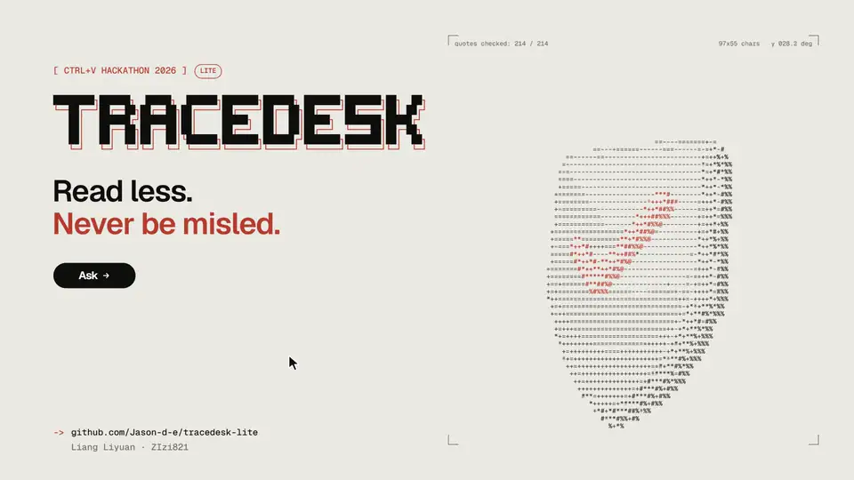

<p align="right">
  <a href="README.md"></a>
  <a href="README.zh-CN.md"></a>
</p>

# TraceDesk Lite

**先说结论，再列清单，每一句都有出处。**

[](https://youtu.be/eEHcymuLP58)

演示视频（3 分 13 秒）：https://youtu.be/eEHcymuLP58

> 本文译自英文版 [README.md](README.md)，如有出入，以英文版为准。

TraceDesk Lite 是一个面向学生组织的帮助台助手，专为难以从冗长、密集的文字中找到行动要点的读者设计，包括有 ADHD 或其他注意力、阅读、执行功能困难的人，以及以英语为第二语言的读者。它只根据组织当前有效的文件作答。每一句话、每一个清单步骤都必须引用这些文件，服务器会在显示任何内容之前逐字核对每一条引文。

> 状态：可运行的原型，v0.4（2026 年 11 月）。演示使用一个**虚构**的社团 “DemoClub”，其文件不代表任何真实的服务或政策。

## 要解决的问题

实用的学生信息（截止时间、参加条件、如何取消、找谁联系）通常分散在好几份密密麻麻的英文文件里，其中一些还已经过时。对一部分人来说，读这些文件是实实在在的障碍：

- **注意力与工作记忆。** 长段落很难读完；藏在句子中间的条件容易漏看；多步骤的说明很难记在脑子里。
- **时间盲。** 写在段落里的截止时间很容易被忽略，直到错过为止。
- **难以开始。** 不清楚第一步该做什么。

AI 摘要可能有帮助，但一段流畅却编造或改动了截止时间的摘要，恰恰会对最依赖它的人造成最大的伤害。TraceDesk 的原则是：**读得更少，但绝不被误导。**

## 封面（`/`）

第一屏说明产品做什么，并让你一键试用。一段简短的动画在一张纸质书桌上播放一次：演示文件中的一条真实规定被划上下划线，一张索引卡滑出并写着一句话答案，清单中的一步被勾选，最后盖上“引文已核对”的印章。开启“减少动态效果”时，会直接显示动画的最终画面。下方依次是：同一条规定的原文段落与回答对比、实测结果、阅读功能、组织者后台、运行所需条件，以及一些真实示例问题，点击后会打开帮助台并直接提出该问题。

## 读者端：帮助台（`/#/ask`）

**一次只用一种语言。** 中文 / EN 开关会切换所有标签、按钮、提示和示例问题，并记住你的选择。回答使用提问所用的语言。中文界面里唯一保留英文的是原文引文，并标注“英文，未翻译”，让读者知道原因。

**问题按话题分组。** 示例问题不是堆成一面墙，而是放在五个标签页下：时间安排、报名与取消、参加条件、帮助与联系，以及“试试刁钻问题”（含糊的、资料里没有的或带有诱导的问题，用来展示助手不会乱猜）。

**每个回答都使用同样的编号布局**，读者总知道该看哪里：

1. **状态横幅。** 一个图标、一个标题和一句话：“已在官方资料中找到”“官方资料里没有这条信息”“先确认一个细节”或“答案已拦下”。
2. **① 一句话结论。** 大字号的一句短句，附“朗读”按钮。其中的关键信息（日期、时间、地点、联系方式）会用荧光笔效果标出，并在下方以带标签的小卡片重复显示，但前提是这些值也出现在已核对的引文里；没有原文支撑的日期绝不会被强调。
3. **② 你需要做的事。** 一份可以打勾的清单。
   - 每一步都以动词开头，截止时间显示在高亮标签里，在手机上也不会被截断。
   - 每一步都注明来自哪份文件，整份清单可以一键复制。
   - **截止时间双重核对。** 某一步截止时间里的每个数字（日、年、小时、分钟）都必须同时出现在这一步已核对的引文中，即使回答是中文、原文是英文也一样。未通过的截止时间会以红色显示并附警告。
4. **③ 更多细节**，默认折叠。
5. **④ 依据。** 引文按文件分组，并在原段落中以下划线标出，附“引文已核对 3/3”标签。
6. **报告问题**或**请组织者补充这条信息**。

**阅读设置**（一个抽屉面板，设置保存在浏览器中）：

- **专注模式**：只保留问题和答案，隐藏其他所有内容，并停止动画。
- **字号**：标准、大或特大。
- **英文单词开头加粗**：有些读者觉得这样更容易读下去，但相关证据不一，所以默认关闭。
- **朗读语速**：朗读使用浏览器自带的语音，不产生额外费用。
- **颜色主题**：浅色（默认）、深色或跟随设备。

**最近的问题**会保留在当前浏览器标签页的侧边栏中，问第二个问题后前一个答案不会丢失。打开后台再返回也会保留。

**诚实的结果。**

- **未经核对的内容绝不当作事实显示。** 如果一个回答的所有引文都无法与原文对上，该回答会被拦下。
- **只用当前有效的文件。** 已被取代的旧稿会列出来，但绝不会发送给模型。
- **能识别提示注入。** 诸如“别管资料了”或“编一个电话号码”之类的隐藏指令不会被执行，而同一条消息中真正的问题仍会得到回答。

## 组织者端：后台（`/#/organiser`）

侧边菜单中有五个部分（手机上为菜单按钮）：

| 部分 | 组织者能看到和做的事 |
| --- | --- |
| **总览** | 提问数量、由资料回答的比例、资料未覆盖的比例、待处理的反馈；一张处理结果图表和一张最需要补充的信息图表。 |
| **读者反馈** | 每条反馈连同当时给出的回答、引用来源和读者备注。可按待处理 / 已完成筛选，填写处理方式，标记为已完成或重新打开，并把全部内容导出为能在 Excel 中正确打开的 CSV 文件（UTF-8，防公式注入）。 |
| **资料缺口** | 资料无法回答的问题，分组并计数。读者明确要求补充的条目排在最前，让组织者知道下一步该写什么。只统计在帮助台中输入的问题，不含测试。 |
| **资料库** | 每份文件的编号、版本、状态和生效日期。已被取代的旧稿会显示被哪份文件取代。 |
| **回答质量** | 下文的提示词对比，以图表和表格呈现，并在旁边注明其局限。 |

读者的反馈只有在勾选同意框后才会保存，表单也会提醒读者不要填写个人信息。

设计遵循 W3C 指南 *Making Content Usable for People with Cognitive and Learning Disabilities*（COGA，让内容对认知和学习障碍者可用），并以 WCAG 2.2 AA 为基线。本应用**不是医疗工具**：它从不询问、也不记录任何健康信息。

## 工作原理

```
web/ (React + Mantine, built to web/dist)  ──POST /api/ask──►  server.js (Express)
                                              ├─ lib/knowledge.js  load data/knowledge.json, keep active sections only
                                              ├─ lib/prompts.js    instructions + documents + JSON schema (key_point, next_steps, citations…)
                                              ├─ lib/answer.js     one Claude API call with structured JSON output
                                              ├─ lib/validate.js   check every quote and every deadline against the source
                                              ├─ lib/runlog.js     append each run to logs/runs.jsonl
                                              └─ lib/reviews.js, lib/insights.js   reader reports and knowledge gaps
```

（上图各模块：`knowledge.js` 加载知识库并只保留有效段落；`prompts.js` 组装指令、文件和 JSON schema；`answer.js` 发起一次结构化输出的 Claude API 调用；`validate.js` 对照原文核对每条引文和每个截止时间；`runlog.js` 把每次运行追加到 `logs/runs.jsonl`；`reviews.js`、`insights.js` 处理读者反馈和资料缺口。）

- **两种引擎。** 有密钥时，服务器通过官方 Anthropic SDK 发起一次 Messages API 调用（`claude-haiku-5-5`，当前最便宜的 Claude 模型，effort 为 `medium`）。没有密钥，或读者在帮助台选择**本地引擎**时，由 `lib/local.js` 按大语言模型出现之前帮助台的方式作答：问题被转成关键词（英文单词做轻度词干化；中文短语通过一个小词表转换），对有效文件中的每个句子按所含关键词打分，得分最高的句子作为一句话结论，逐字引用。读起来像指令的句子会成为清单步骤：用文件原话写出指令本身，并把截止时间单独提出放在旁边，绝不会出现只是重复结论的步骤。保留两条规则：它会追问指的是哪个链接；什么都匹配不上时，它会说“资料未覆盖”（并给出文件中记载的联系方式）。它从不改写、合并或翻译。两种引擎都经过同样的核对。
- **资料无法回答时**，帮助台会起草读者要发送的邮件（`lib/email.js`）：文件中记载的支持邮箱、读者原本的问题、已查阅的文件，以及支持指南要求请求中包含的内容。可以复制，也可以在邮件程序中打开；不会自动发送任何内容。
- **结构化输出。** JSON schema 把每个 `source_id` 限定为真实存在且有效的段落。
- **没有检索层。** 知识库很小，所以所有有效段落都直接放进提示词；没有向量搜索。
- **密钥处理。** API 密钥只从 `app/.env` 读取，从不读取系统环境变量，也绝不发送到浏览器。
- **日志。** 每次运行都会记录模型、提示词版本、知识库版本、延迟、token 用量和核对结果。
- **界面。** 单页 React 应用。所有界面文字都放在两个语言文件中（`web/src/locales/en.ts`、`zh.ts`），组件里不写死任何文字。后台及其图表只在组织者打开时才下载。
- **视觉设计。** 封面、帮助台和后台使用同一套视觉系统：暖色纸张、棉质文具质感、凸版印刷卡片风格的控件，英文使用 General Sans、中文使用 Noto Sans SC，并且只用一种珊瑚色墨水表示“已核对”状态、焦点和链接。颜色使用经过对比度检查的 OKLCH 色彩 token。动效仅限于封面的一段动画和简短的状态变化（按下、答案出现），除封面动画外都在 300 毫秒以内；开启减少动态效果时全部关闭。

## 目前的实测结果（真实模型运行，2026-11-09）

| 项目 | 结果 |
| --- | --- |
| 真实模型调用 | 214 次，全部成功：20 次冒烟测试调用、72 个在应用中输入的问题（包括用于截图的问题）和 122 次评测调用。这些都只是演示问题，因此这不是准确率评估。 |
| 未通过核对的引文和步骤 | 214 次调用中为 0 |
| 符合预期结果（冒烟用例 TD-001、018、021、029、033、037、040） | 7 / 7 |
| 响应时间中位数 / 最大值 | 3.4 秒 / 10.6 秒 |
| 全部 214 次调用的总费用 | 约 0.13 美元 |
| 自动无障碍检查（axe-core 4.10.2，WCAG 2.2 A/AA 规则及最佳实践） | 封面、显示回答的帮助台以及后台全部五个部分均为 0 项违规；在中文和英文、浅色和深色、桌面和 375 px 手机宽度下都检查过，且没有横向滚动 |
| 40 题提示词对比（promptfoo）：简单提示词 vs TraceDesk 提示词，使用相同的模型、文件、schema 和服务器检查 | 在 20 道留出题上，TraceDesk 提示词（v2.4）有 **20/20** 题通过全部自动检查，简单提示词为 **17/20**。更早的一次运行（v2.3）为 19/20 对 15/20。简单提示词在同一批题目上先后得到 15 和 17，所以几道题的差距可能只是运行间的随机波动。剩下的差异全部是清单中的截止时间在引文里没有写明。TraceDesk 提示词每题费用高约 40%，响应时间中位数慢约 1.6 秒。这只是自动检查，不是准确率数字。详见 `EVALUATION.md`。 |

## 在本地运行（Windows、macOS 或 Linux）

要求：Node.js 22 或更新版本，以及一个 Anthropic API 密钥。

```bash
cd app
npm install
copy .env.example .env        # macOS/Linux: cp .env.example .env
# open .env and paste your key after ANTHROPIC_API_KEY=
npm start                     # then open http://localhost:3000 (help desk: /#/ask, dashboard: /#/organiser)
```

（打开 `.env`，把密钥粘贴在 `ANTHROPIC_API_KEY=` 后面；启动后打开 http://localhost:3000，帮助台在 `/#/ask`，后台在 `/#/organiser`。）

仓库中已包含构建好的界面（`app/web/dist`），所以运行应用不需要构建步骤。

| 命令（在 `app/` 中） | 作用 |
| --- | --- |
| `npm test` | 运行 27 个离线测试：知识库加载、引文和截止时间核对、拦截回答、反馈队列及其 CSV 导出，以及资料缺口分析。不调用 API。 |
| `npm run smoke` | 对 `app/scripts/smoke-cases.json` 中的 7 个演示问题发起真实模型调用。 |
| `npm run smoke -- TD-018 TD-029` | 只运行你指定的用例。 |

修改界面：

```bash
cd app/web
npm install
npm run dev      # live-reloading interface on http://localhost:5173 (keep `npm start` running in app/ for the API)
npm run build    # type-check and rebuild app/web/dist
```

（`npm run dev` 在 http://localhost:5173 启动热更新界面，需同时在 `app/` 中保持 `npm start` 运行以提供 API；`npm run build` 做类型检查并重新构建 `app/web/dist`。）

## 各部分的完成时间（披露）

| 日期（MYT） | 工作内容 |
| --- | --- |
| 2026-11-03 | 虚构的 DemoClub 知识库（`data/knowledge.json`）和一组测试问题草稿。没有应用代码。 |
| 2026-11-09 起 | `app/` 中的全部内容：服务器、引文和截止时间核对、无障碍功能、测试和冒烟脚本。网页界面最初用纯 HTML 编写，当天又用 React 和 Mantine 重写，因为我们自己试用后发现语言混杂、标签不清晰、示例没有分组。同一天晚些时候我们加入了封面，并让整个界面使用统一的视觉系统。 |

**AI 辅助。** 虚构文件和问题草稿是在 AI 帮助下写成的。应用代码由 AI 编程助手（Claude Code）在团队指导下编写。

**复用的成果。** 只要有合适的开源组件，我们就直接使用。全部组件及其版本和许可证列在 `THIRD_PARTY_NOTICES.md` 中：

- 界面：React、Mantine（组件、图表、通知）、Recharts、Tabler Icons、i18next、Vite。
- 朗读使用 easy-speech；英文单词开头加粗使用 text-vide；关键信息用 chrono-node 识别，用 Rough Notation 标注。
- 回答风格规则改编自 i-have-adhd。
- 设计：视觉系统是 Hallmark 设计技能（MIT）中的 “Coral” 主题，从它提供的三个主题中选出；动效遵循 Emil Kowalski 的设计工程技能（MIT）；Impeccable 的质量规则（Apache-2.0）用作最终检查清单。字体：General Sans（Fontshare）、Geist Mono 和 Noto Sans SC（均为 OFL）。

## 已知局限

- **尚未做用户测试。** 还没有 ADHD 人士试用过这个应用。它是*参照*认知无障碍指南设计的；我们不声称它已被证明有帮助。
- **引文核对有局限。** 它能证明引用的文字确实存在于原文中，但不能证明这条引文完全支持对应的句子，这仍需要人工审核。截止时间核对只比较数字。
- **本地引擎只会挑选句子。** 它不能把两个段落合并成一个回答；中文问题得到的是在中文引导语下的英文原句；词表不认识的说法会返回“资料未覆盖”。在 34 个演示问题上，它为 29 个选对了句子，对 2 个进行了追问，对 3 个回答“资料未覆盖”；关键词仍可能落到错误的句子上。
- **演示规模小且是虚构的。** 演示只有四份简短的虚构文件，在其上的结果不能说明它在真实材料上的准确率。
- **自动无障碍检查不够。** 自动检查工具只能发现一部分问题。尚未由真实用户进行读屏软件和纯键盘操作测试。
- **朗读取决于浏览器。** 可用的语音取决于浏览器和操作系统。
- **字体从 Fontshare 和 Google Fonts 加载。** 离线时，页面会退回系统无衬线字体。
- **单用户本地原型。** 没有账号系统，频率限制只保存在内存中，也没有公开部署。后台没有登录，之所以可以接受，只是因为服务器只监听本机（127.0.0.1）。
